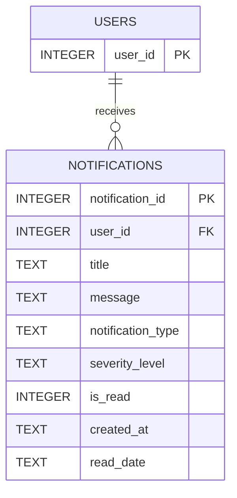

# Service 8 Notification and Alert Management

Implemented by Youssef Al Hajj Youness.

Service 8 stores one notification for one existing Service 1 user. It uses the
shared SQLite database and Service 1 JWT authentication. No email, SMS, queue,
or automatic incident/threat generation is included in this stage. Other
services can POST to this API with an authorized Service 1 token. Internal
Python callers can reuse `Notification` and `repository.insert_notification`.

## Run

From the project root in the existing virtual environment:

```powershell
python -m pip install -r requirements.txt
python -m database.init_db
python -m user_service.app
```

In another terminal with the same `DB_PATH` and `SECRET_KEY` environment:

```powershell
python -m notification_service.app
```

Service 1 listens on port 5001; Service 8 on port 5008. Log in through
`POST /users/login` and send `Authorization: Bearer <token>` to Service 8.
Set the existing `ADMIN_PASSWORD` and `SECRET_KEY` configuration for your local
environment before initialization. No test passwords or tokens are committed
in the Service 8 collection folder.

```powershell
python -m unittest discover -s tests -v
```

## Requests and responses

All responses follow the existing `status`, `message`, `data` success envelope.
Errors have `status: error` and a meaningful `message`.

| Method and path | Required input | Success | Behavior |
|---|---|---|---|
| POST /notifications | JSON below | 201 | Create one Unread notification |
| GET /notifications/user/{user_id} | Positive recipient ID | 200 | List; an existing user with no notifications returns `data: []` |
| GET /notifications/{id} | Positive notification ID | 200 | Retrieve one permitted notification |
| PUT /notifications/{id}/read | Positive ID; no body required | 200 | Set Read and first read timestamp |
| GET /notifications/search | At least one filter below | 200 | Combine supplied filters using AND |
| DELETE /notifications/{id} | Positive notification ID | 200 | Delete notification; preserve user |

Example POST body (use a real user ID):

```json
{
  "user_id": 2,
  "title": "Security Alert",
  "message": "Suspicious activity was detected.",
  "notification_type": "Security Alert",
  "severity_level": "High"
}
```

The project uses `severity_level`, so `severity` is not an accepted alias.
All five fields are required. `user_id` must be a positive JSON integer within
SQLite's signed 64 bit range. Title accepts 1–255 characters after trimming;
message accepts 1–4000. Text cannot contain control characters. Unknown body
fields, including client supplied dates/status, are rejected.

Types: Incident Assignment, Security Alert, System Notification, Threat Alert,
Vulnerability Alert. Severities: Low, Medium, High, Critical. Choices follow
the shared validator: case insensitive input, canonical stored spelling.

Search parameters: `user_id`, `notification_type`, `severity_level`, `status`.
Status accepts Unread or Read. Example:
`/notifications/search?notification_type=Security%20Alert&status=Read`.
Empty, repeated, unknown, or invalid filters return 400. A nonexistent filtered
recipient returns 404 for an authorized caller. A valid search with no matches
returns `data: []`.

Validation errors use 400, missing/invalid/expired authentication 401,
permission denials 403, absent accessible resources 404, and insertion conflicts
409. Unsupported methods use the shared JSON 405 handler. For employees and
analysts, an inaccessible or absent specific notification returns the same 403
to avoid revealing other recipients' records.

## Permissions and specification decisions

| Operation | Administrator | Analyst | Regular User | Auditor |
|---|---|---|---|---|
| Create | Yes | No | No | No |
| User history / specific notification | Any | Own | Own | Any |
| Mark read | Any | Own | Own | No |
| Search | Any | Own results | No | Any |
| Delete | Yes | No | No | No |

The original specification's global roles say Analysts view assigned
notifications and Regular Users view personal notifications. The Service 8
endpoint list gives these roles access without defining ownership scope. This
implementation applies the narrower global scope. The live database role and
account status are reloaded by the shared auth helper on each request;
permission violations use its existing audit logger.

Required paths are preserved. Every route docstring contains the responsible
student's full name, following Service 1's precedent. The instructor's phrase
“Each route … must include the Full student name” remains ambiguous about
attribution placement; no name was inserted into the required API URLs.

## Database and upgrade decisions

The existing `notifications` table retains its primary key, `user_id` foreign
key, optional `incident_id`, `is_read`, and `created_at`. Type, severity and
`read_date` are added. API `status` is derived from `is_read` (0 = Unread,
1 = Read), avoiding two conflicting stored state values. `created_at` is the
creation date; both date fields use SQLite UTC `YYYY-MM-DD HH:MM:SS` timestamps.

Run `python -m database.init_db` to initialize or upgrade. The additive migration
is repeatable and preserves IDs, original timestamps, and relationships.
Legacy rows lacked type/severity; they receive explicit compatibility defaults
System Notification / Low. These defaults do not reconstruct their original
classification. Historical read times cannot be recovered and remain NULL.
A later read acknowledgement fills a missing time with that acknowledgement's
time; it does not claim to recover the original read time. New API records always
start Unread with NULL read_date. Repeated read requests preserve the first time.

User deletion keeps the pre-existing ON DELETE CASCADE behavior. Deleting a
notification never deletes its user. The optional incident relationship remains
ON DELETE SET NULL. No Service 3 or Service 9 routes are implemented.



## Manual Postman requests

Import the project's existing collection; use the folder
`Service 8 - Notification and Alert Management`. Start both services and create
the users you need through Service 1. Set the username/password variables
locally, run each login request, and copy its returned token into `adminToken`,
`employeeToken`, `analystToken`, or `auditorToken` as appropriate. Set
`recipientId`, `emptyUserId`, and the returned `notificationId` manually.
The requests include descriptions and expected HTTP statuses; no runner or
scripts are required. Use Postman and your SQLite viewer for the instructor's
screenshots. Keep screenshots and local credentials outside Git.

Keep all screenshots, reports, databases, and environment exports outside Git.
The instructor requires actual Postman screenshots in the final team report.
The final report must also acknowledge AI assistance where used and comply with
the instructor's authorship requirements; code/tests alone do not satisfy that
submission requirement.

## Known shared dependency defects

Shared authentication is unchanged from main. A deliberately signed token with
`iat: null` or a numeric subject outside SQLite's integer range produces 500
instead of 401 in both Service 1 and Service 8. Ordinary invalid, expired, and
wrong-signature tokens return 401. A team fix should
validate JWT claim types/ranges and catch conversion/type errors in shared auth.
